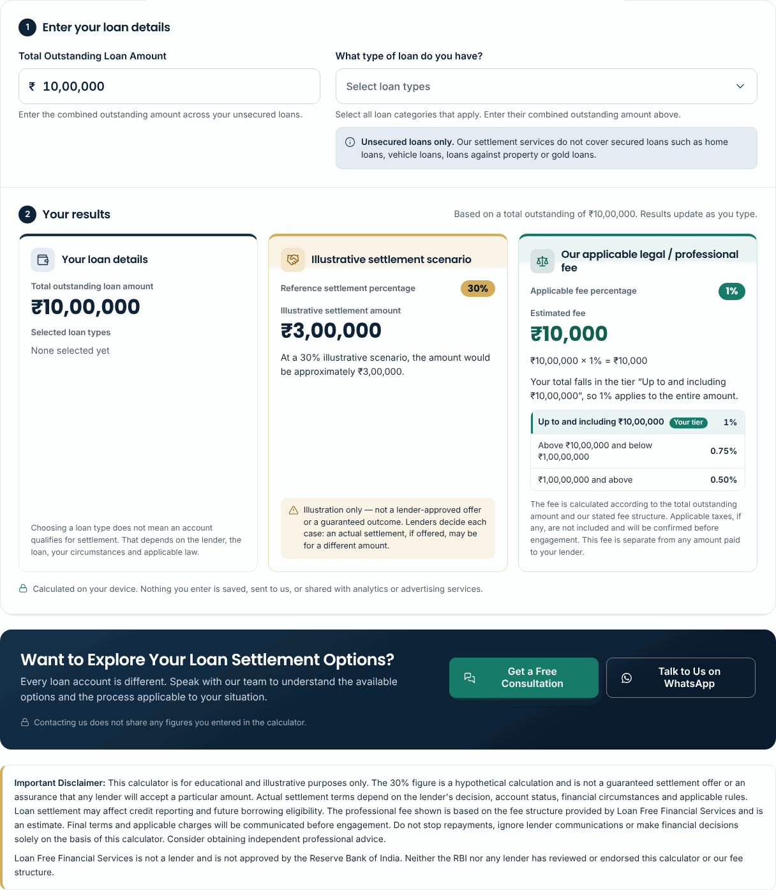
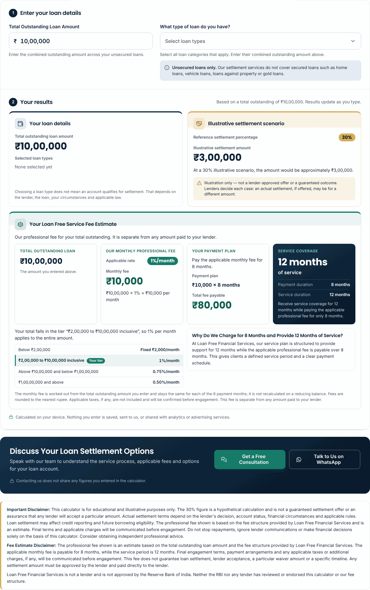
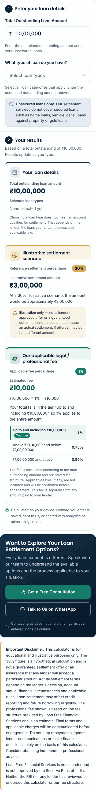
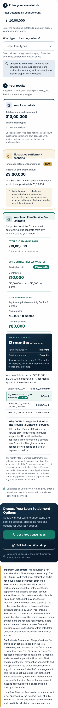
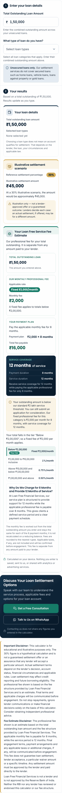

# Calculator pricing update — monthly fee, 8-month payment, 12-month service

Date: 3 Nov 2026 · Branch: `claude/adoring-ritchie-dihjg4` (from `main` at `506c40f`) · URL: `/settlement-calculator.html` (unchanged)

**Status: committed and pushed to the feature branch only.** Nothing has been merged or deployed, and no Vercel setting was changed. Vercel builds production from `main`. The business decisions in §15 should be confirmed before this is merged.

---

## 0. What the repository contained (read this first)

The brief describes a calculator with monthly income/expense fields, savings calculations and sliders. **That calculator no longer exists in the repository.** It was the Phase 3 budget planner. It was replaced on 3 Nov 2026 by the two-field "Loan Settlement & Legal Fee Calculator", merged to `main` with the owner's approval (brandzoomediaagency-coder/Loan-Free-Financial-Services-#4 and #5; see `docs/SIMPLE_CALCULATOR_IMPLEMENTATION_REPORT.md`).

As the brief instructs, the repository was treated as the source of truth. Before this change it had:

| Part | Behaviour before this update |
|---|---|
| Inputs | Total Outstanding Loan Amount (₹, Indian grouping as you type); optional multi-select of 7 unsecured loan types |
| Card 1 — Your loan details | Total outstanding and the selected loan types |
| Card 2 — Illustrative settlement scenario | Fixed 30% reference (`SETTLEMENT_SCENARIO_PERCENT`), labelled hypothetical |
| Card 3 — Our applicable legal / professional fee | 1% / 0.75% / 0.50% of the total, shown as **one** fee (₹10 lakh → ₹10,000) |
| CTA | "Want to Explore Your Loan Settlement Options?" with Get a Free Consultation (existing dialog) and Talk to Us on WhatsApp (existing number, neutral message) |
| Disclaimer | Business-supplied "Important Disclaimer" plus "not a lender / not RBI-approved" |
| Privacy | All client-side; nothing stored, sent, logged or put in the URL; one parameter-free `calculator_used` GA4 event |

Two consequences:

- **The 30% scenario was kept.** The brief says not to *introduce* an automatic 30% estimate and to preserve the existing settlement calculation. The 30% scenario is the existing, owner-approved calculation, so it was kept unchanged: same formula, wording, caution and disclaimer. It was not extended to any new figure. If the business wants it removed, that is a separate decision (§15, item 6).
- **Card 3 was upgraded in place, not duplicated.** Under the new policy the 1% / 0.75% / 0.50% rates are *monthly*. Keeping the old card ("Estimated fee ₹10,000") beside a new section ("₹10,000 × 8 = ₹80,000") would show two contradictory fees for one amount. The old fee card was therefore turned into the new **"Your Loan Free Service Fee Estimate"** section. It keeps the same green card style, icon, tier list with "Your tier" highlight, calculation line and fine print, and adds the payment plan and service coverage.

## 1. Existing features preserved

| Feature | Status |
|---|---|
| Amount field, parsing, live Indian grouping, caret handling, error messages, `aria-invalid` | Unchanged |
| Loan-type multi-select (mouse, keyboard, Escape, outside click, Select all / Clear all, chips) | Unchanged |
| "Unsecured loans only" note | Unchanged |
| Card 1 "Your loan details" | Unchanged |
| Card 2 "Illustrative settlement scenario" (30%) — formula, text, caution | Unchanged; tested that the fee never alters it |
| Empty/invalid state (dashes, never ₹0 fees) | Kept and extended to the new fee figures |
| Consultation dialog, WhatsApp link (`wa.me/917042538878`, neutral message), lead-form WhatsApp fallback | Unchanged; `site.js` is byte-identical (`site.9b8b6a03f2.js`) |
| "Important Disclaimer" and "not a lender / not RBI-approved" | Unchanged; the fee disclaimer was added between them |
| Privacy rules, single `calculator_used` event | Unchanged; re-verified in the browser |
| URL, canonical, breadcrumbs, sitemap entry, robots, H1, OG image | Unchanged |

**Layout change.** The results grid is now loan details and settlement scenario side by side, with the fee estimate as a full-width row below. This was already the tablet layout (640–959 px); it now also applies on desktop instead of three narrow columns, because the fee section holds four figures. Phones are still one column.

## 2. New pricing policy implemented

One central configuration object, `CONFIG` in `src/js/calculator.js`. The build, page copy, FAQ answers, tables, illustration and tests all read the same object.

```js
MIN_STANDARD_OUTSTANDING: 200000,   // standard engagement starts here
BELOW_MINIMUM_MONTHLY_FEE: 2000,    // fixed fee below it
PAYMENT_MONTHS: 8,
SERVICE_MONTHS: 12,
FEE_TIERS: [
  { id: 'tier-1', bps: 100, min: 200000,   max: 1000000,  maxInclusive: true,  label: '₹2,00,000 to ₹10,00,000 inclusive' },
  { id: 'tier-2', bps: 75,  min: 1000000,  max: 10000000, maxInclusive: false, label: 'Above ₹10,00,000 and below ₹1,00,00,000' },
  { id: 'tier-3', bps: 50,  min: 10000000, max: Infinity, maxInclusive: false, label: '₹1,00,00,000 and above' }
]
```

The fixed band (`tier-0`, "Below ₹2,00,000") is built from the first two values, and `FEE_SCHEDULE` lists all four bands in order. Rates are in basis points so the arithmetic is exact. One function, `feeEstimate(amount)`, returns everything the page shows.

## 3. Exact fee-tier formulas

| Total outstanding (A) | Condition in code | Monthly fee |
|---|---|---|
| Below ₹2,00,000 | `0 < A < 200000` | ₹2,000 (fixed, not a percentage) |
| ₹2,00,000 to ₹10,00,000 inclusive | `200000 <= A <= 1000000` | A × 1% |
| Above ₹10,00,000 and below ₹1,00,00,000 | `1000000 < A < 10000000` | A × 0.75% |
| ₹1,00,00,000 and above | `A >= 10000000` | A × 0.50% |

- Flat rate: the band's rate applies to the **entire** total, not progressive slabs (₹25 lakh → ₹18,750 a month, not ₹21,250).
- The monthly fee is rounded to the nearest rupee. **Total fee = rounded monthly fee × 8.** For example, ₹2,00,040 → ₹2,000.40 → ₹2,000 a month → ₹16,000, not ₹16,003.
- The same monthly fee is shown for each of the 8 months. It is not recalculated on a reducing balance.
- Empty, zero, negative, non-numeric and above-₹1,000-crore amounts return no estimate (`feeEstimate` → `null`), so the page shows dashes.
- No GST or other charge is added.

## 4. Below-₹2-lakh behaviour

For any valid amount below ₹2,00,000:

- The fee shows **Fixed ₹2,000/month**, ₹2,000 × 8 months = **₹16,000**, and **12 months** of service. The "Below ₹2,00,000" band is highlighted.
- This message appears under the four figures:
  > Your outstanding amount is below our standard ₹2 lakh service threshold. You can still submit an application for consideration. Our fixed professional fee for this category is ₹2,000 per month for 8 months, with service coverage for 12 months.
- No error and no "ineligible" label. The input stays valid, and the consultation and WhatsApp buttons work exactly as for any other amount (browser-tested).
- Screen readers hear a short version of the message with the result summary.

## 5. Monthly fee examples (all automated)

| Outstanding | Band | Monthly fee | Payment plan | Total fee | Service |
|---|---|---:|---|---:|---|
| ₹1,50,000 | Fixed | ₹2,000 | ₹2,000 × 8 months | ₹16,000 | 12 months |
| ₹2,00,000 | 1% | ₹2,000 | ₹2,000 × 8 months | ₹16,000 | 12 months |
| ₹5,00,000 | 1% | ₹5,000 | ₹5,000 × 8 months | ₹40,000 | 12 months |
| ₹10,00,000 | 1% | ₹10,000 | ₹10,000 × 8 months | ₹80,000 | 12 months |
| ₹25,00,000 | 0.75% | ₹18,750 | ₹18,750 × 8 months | ₹1,50,000 | 12 months |
| ₹1,00,00,000 | 0.50% | ₹50,000 | ₹50,000 × 8 months | ₹4,00,000 | 12 months |
| ₹1,50,00,000 | 0.50% | ₹75,000 | ₹75,000 × 8 months | ₹6,00,000 | 12 months |

These are also published as the "Professional fee examples" table on the page, generated from `CONFIG`.

## 6. 8-month payment calculation

- Shown as "Pay the applicable monthly fee for 8 months.", then "Payment plan: ₹10,000 × 8 months" and "Total fee payable: ₹80,000".
- Tests confirm that total ÷ monthly = 8 for every example and that no total is ever monthly × 12.
- No payment dates, due dates or extra charges are shown or implied.

## 7. 12-month service coverage

- A dark navy block in the fee section shows **"12 months of service"** prominently, with "Payment duration: 8 months" and "Service duration: 12 months" underneath. It also carries the line "Receive service coverage for 12 months while paying the applicable professional fee for only 8 months."
- These durations are policy, not a calculation, so they are visible even before an amount is entered.
- An explainer box, **"Why Do We Charge for 8 Months and Provide 12 Months of Service?"**, uses the business wording, with no competitor comparisons or guarantees.
- The page states "There are 8 monthly payments, not 12." Unit tests confirm no copy says 12 payments or instalments, or calls the service free (the business name "Loan Free" is excluded from that check).

### Settlement and fee kept separate

- The fee section opens with "It is separate from any amount paid to your lender." The fine print says the same.
- The new fee disclaimer ends "Any settlement amount must be approved by the lender and paid directly to the lender."
- Tests confirm the results contain only `outstanding`, `settlement` and `fee`, with no combined, payable or savings figure. The settlement amount equals the unchanged 30% formula for every example.

### CTA and disclaimer

- The existing CTA block (directly below the fee estimate) now reads **"Discuss Your Loan Settlement Options"** with "Speak with our team to understand the service process, applicable fees and options for your loan account." The **Get a Free Consultation** and **Talk to Us on WhatsApp** buttons and their behaviour are unchanged. No second CTA was added.
- **Fee Estimate Disclaimer** added in full, as supplied, between the two existing disclaimer paragraphs.

## 8. SEO metadata

| | Before | After |
|---|---|---|
| Title | Loan Settlement Calculator & Legal Fee Estimator \| Loan Free (60) | **Loan Settlement Calculator & Fee Estimate India \| Loan Free** (59) |
| Description | Explore an illustrative loan settlement scenario and calculate the applicable professional fee based on your total outstanding loan amount. | **Explore your loan settlement scenario and calculate Loan Free's monthly professional fee, 8-month payment plan and 12-month service coverage.** (141, as suggested) |
| Canonical | `https://www.loanfree.info/settlement-calculator.html` | Unchanged |
| H1 | Loan Settlement & Legal Fee Calculator | Unchanged (keeps "legal fee"; OG image did not need regenerating) |
| Hero subtitle | …calculate the applicable professional fee… | …estimate our monthly professional fee, 8-month payment plan and 12-month service period… |
| Robots / sitemap | index, follow; in sitemap | Unchanged (`lastmod` 2026-11-03) |
| Structured data | ProfessionalService, BreadcrumbList, WebPage, FAQPage (8 Q&As) | Same four types; FAQPage now 17 Q&As, all visible on the page |

The suggested title, "Loan Settlement Calculator & Service Fee Estimate India | Loan Free", is 67 characters. That exceeds the site checker's 62-character limit and would likely be cut off in Google results. The 59-character version keeps "Loan Settlement Calculator", "Fee Estimate" and "India".

`llms.txt` picks up the new description automatically. The illustration (`calculator-planning.svg`) now reads "Monthly fee 1% / mo, ₹10,000, × 8 months = ₹80,000, 12 months of service", generated from `CONFIG`. Its alt text was updated on the page and the homepage.

## 9. Keywords implemented

These are intent-based targets, not verified search volumes. They were placed only where they read naturally. On the built page:

| Phrase | Where it appears |
|---|---|
| Loan settlement calculator | Title; H1 ("Loan Settlement & Legal Fee Calculator") |
| India | Title |
| Fee estimate / service fee | Title; "Your Loan Free Service Fee Estimate"; fee disclaimer |
| Legal fee | H1 (unchanged) |
| Professional fee, monthly fee, payment plan | Description, calculator, answer section, tables, FAQs |
| Loan settlement service cost | H2 "How much does loan settlement service cost at Loan Free?" |
| Loan settlement fee | H2 "Our loan settlement fee structure" |
| Loan settlement charges | "Loan settlement charges come in two separate parts…" |
| Personal loan settlement, credit card settlement | Answer section (internal links to both service pages); related links |
| Loan settlement services | Existing copy ("Our settlement services cover unsecured loans only") |

Long-tail questions answered directly, as FAQs or the answer section: service cost; how fees are calculated; monthly charges; minimum amount; applying below ₹2 lakh; fee below ₹2 lakh; fee for ₹10 lakh; fee for ₹1 crore; 8 months vs 12 months; settlement amount vs professional fee; whether the fee guarantees settlement; who receives the fee; multiple accounts; taxes. Fees for ₹2 lakh, ₹5 lakh and above ₹10 lakh appear in the examples table, and credit card fees in the answer section.

**Not added on purpose:** "debt settlement calculator" and "debt resolution services". Neither appears in the site's own wording, and adding them only for search would be keyword stuffing.

## 10. AEO — answer section and FAQs

**New H2, directly after the calculator: "How much does loan settlement service cost at Loan Free?"** The answer is generated from `CONFIG` and pinned word-for-word by a test:

> Loan Free Financial Services calculates its professional fee using the total outstanding loan amount. For outstanding amounts below ₹2 lakh, the fixed fee is ₹2,000 per month. From ₹2 lakh to ₹10 lakh, the monthly fee is 1%; above ₹10 lakh and below ₹1 crore, it is 0.75%; and at ₹1 crore or above, it is 0.50%. The applicable monthly fee is payable for 8 months, while services are provided for 12 months.

If the tiers change shape (more tiers, different boundaries), the build fails rather than publishing a wrong sentence.

**FAQs: 17 in total.** Nine are new (questions 1–3, 5–9 and 11 from the brief). Three existing fee answers were rewritten for the monthly model: how the fee is calculated, "Is the fee paid to my lender?" (now "Does the lender receive the professional fee?") and "Does the fee include GST…" (now "Are taxes or additional charges included in the estimate?"). The five remaining existing questions are unchanged (30% scenario, secured loans, privacy, stopping EMIs, credit report). Every figure in the answers comes from `CONFIG` through build tokens. The few literal figures in question titles and the meta description are checked against `CONFIG` by a unit test.

The site's existing build adds FAQPage data for any page with accordion FAQs. No new schema types were added: no Offer, PriceSpecification, Review or Rating.

## 11. GEO improvements

- A plain statement that Loan Free Financial Services **is not a lender** and provides loan settlement guidance and related support for unsecured loans, with links to the credit card and personal loan settlement pages.
- Fee bands, the 8-month payment and the 12-month service are all **static HTML text**: page tables, answer, FAQs, the calculator's band list and policy lines. None of them depend on JavaScript.
- Descriptive heading outline: H1 → H2 (answer, how it works, fee structure, examples, FAQ) → H3 (payment plan and service period, fee examples, settlement examples); inside the calculator H3 cards → H4 blocks. `check.mjs` reports no skips.
- Business name, phone, WhatsApp and service area come from the existing `src/site.config.mjs` (untouched). No authors, reviews, credentials, rankings or outcomes were added.

## 12. Privacy safeguards verified

| Check | Result |
|---|---|
| Static: no storage APIs, network APIs, URL writes, console, `fbq`/`dataLayer` calls or WhatsApp links in `calculator.js` | Pass |
| Static: exactly one `gtag('event', 'calculator_used')`, no parameters | Pass |
| Browser: entering ₹73,42,191 (fee ₹55,066/month, ₹4,40,528 total), then searching every request, the URL, localStorage, sessionStorage, cookies and console for any of those figures (raw, grouped, URL-encoded) or the loan type | Nothing found (calculator page and homepage, 1440 and 390 px, "Accept all" consent) |
| `calculator_used` sent once with no parameters | Pass |
| Meta Pixel not loaded on the calculator page; no pixel event on the homepage while calculating | Pass |
| WhatsApp links and the consultation dialog carry no calculator values | Pass |
| No new endpoint; `api/lead.js`, `vercel.json`, `site.config.mjs`, `site.js` untouched | Confirmed by diff |

## 13. Test results

| Command | Before | After |
|---|---|---|
| `node tools/build.mjs` (Vercel build command) | 57 pages | 57 pages; `site.js` fingerprint unchanged |
| `node tools/check.mjs` | 0 errors, 0 warnings | **0 errors, 0 warnings** |
| `node tools/test-calculator.cjs` | 63 passed | **99 passed, 0 failed** |
| `node tools/test-lead.cjs` | valid lead delivered; honeypot, too-fast, no consent, bad phone, bad origin, wrong secret handled | **Identical output** |
| `node tools/qa/calculator-browser.mjs` | 227 passed | **309 passed, 0 failed** |
| Site sweep (57 pages × 6 widths = 342 loads; Playwright port of `tools/qa/sweep.mjs`) | — | **0 with horizontal overflow, page errors or failed requests** |

**Unit tests added or changed** (`tools/test-calculator.cjs`):

- Policy values; tiers contiguous with no overlap; four-band schedule.
- All 7 examples: band, rate label, monthly fee, × 8, total, 12 months, INR formatting.
- Boundaries: ₹0 (no result), ₹1, ₹1,99,999, ₹1,99,999.99, ₹2,00,000, ₹5,00,000, ₹10,00,000, ₹10,00,000.01, ₹10,00,001, ₹99,99,999, ₹1,00,00,000, ₹1,50,00,000.
- Empty, negative, NaN, Infinity and string inputs; ₹500 crore and ₹1,000 crore.
- Rounding before × 8; paise; "8 payments, not 12"; flat rate rather than slabs.
- Exact threshold crossover points; fixed fee not a percentage; the below-₹2-lakh flag is not an error.
- Settlement unchanged for every example; results never combined.
- Generated copy: answer wording, summary, examples tables, widget text, below-₹2-lakh message, CTA, both disclaimers, no "12 payments / free service" wording, guarantees only in negated form, page literals match `CONFIG`.
- All earlier parsing, loan-type, formatting and privacy tests kept.

**Browser tests added or changed** (`tools/qa/calculator-browser.mjs`):

- Empty state shows dashes plus the 8/12-month policy.
- ₹10 lakh shows outstanding, rate, monthly fee, calculation, plan, total, 12 months and the highlighted band.
- ₹1.5 lakh shows the fixed fee, the exact message text, no error, the fixed band highlighted and the CTAs available.
- Ten amounts typed through the UI (₹1 to ₹500 crore) show the expected settlement, rate, monthly fee, total and message visibility.
- Invalid inputs show no fee and no message.
- Loan types never change the fee.
- CTA text and position below the fee estimate; both disclaimers present.
- New privacy needles for the fee figures.
- At 375 / 390 / 430 / 768 / 1024 / 1440 px with ₹1,000 crore entered: every figure fits inside its block, the four blocks never overlap, and there is no horizontal scroll.
- All earlier checks (multi-select, keyboard, chips, Enter, caret, lead fallback, dropdown fit, 44 px targets) still pass.

Limitation: Google and Meta hosts are blocked from this environment, so tag scripts were stubbed (as in earlier reports). `LIVE_TAGS=1 node tools/qa/calculator-browser.mjs` loads the real tags on a machine with internet access.

**Build output compared with `main`:** 52 of 60 HTML/XML/TXT outputs are identical apart from CSS/sprite fingerprints. The 8 that changed are all expected:

- the calculator page;
- the homepage (calculator section text and its resource card);
- the five pages with the calculator promo box (credit card, personal loan, NBFC, OTS, settlement vs restructuring), where only the promo sentence changed;
- `llms.txt` (description).

## 14. Screenshots

All in `docs/calculator/screenshots/pricing-update/`: 1× element shots with the fixed header and call bar hidden, palette-reduced. Regenerate with `tools/qa/calculator-screenshots.mjs` (see `tools/qa/README.md`). Before shots come from a build of `main` at `506c40f`.

| Before (₹10 lakh, 1440) | After (₹10 lakh, 1440) |
|---|---|
|  |  |

| Before (390) | After (390) | Below ₹2 lakh (390) |
|---|---|---|
|  |  |  |

Also: `after-10-lakh-{375,430,768,1024}.png`, `after-below-2-lakh-1440.png`, `after-1-crore-1440.png` (fee section, 0.50% band), `after-empty-390.png`, `after-homepage-section-1440.png`, `after-fee-content-1440.png` (answer section, fee tables, FAQ).

## 15. Business decisions requiring confirmation

Please review these before merging. Items 1–3 affect what visitors are charged or told.

1. **Threshold effect (flat-rate tiers), implemented exactly as instructed.** Because the lower rate applies to the whole amount once a threshold is crossed, the fee **falls** just above each threshold:

   | Total outstanding | Monthly | Total (× 8) |
   |---|---:|---:|
   | ₹10,00,000 | ₹10,000 | ₹80,000 |
   | ₹10,00,001 | ₹7,500 | ₹60,000 (₹20,000 less) |
   | ₹13,33,267 | ₹10,000 | ₹80,000: first rupee amount above ₹10 lakh back to the ₹10 lakh fee |
   | ₹99,99,999 | ₹75,000 | ₹6,00,000 |
   | ₹1,00,00,000 | ₹50,000 | ₹4,00,000 (₹2,00,000 less) |
   | ₹1,49,99,900 | ₹75,000 | ₹6,00,000: first amount at or above ₹1 crore back to the ₹99,99,999 fee |

   So a visitor with ₹12 lakh pays less (₹72,000) than one with ₹10 lakh (₹80,000), and ₹1.2 crore pays less (₹4,80,000) than ₹95 lakh (₹5,70,000). If this is not intended, the usual alternatives are marginal slabs, or flat tiers with a floor at the previous tier's maximum. Either is a small change to `monthlyFee()` and its tests.

2. **Fee for very small amounts.** Below ₹2 lakh the fee is a fixed ₹16,000 over 8 months whatever the amount, so it is 32% of a ₹50,000 balance and more than the whole outstanding amount below ₹16,000 (₹1 still shows ₹2,000 a month, as the brief's test requires). Consider whether the calculator should show an extra note, or a minimum input, for very small amounts. Nothing is blocked today.

3. **Taxes (GST).** The estimate adds no tax. The page says taxes, if any, are not included and will be confirmed before engagement. Please confirm the approved tax treatment so the wording can be made specific.

4. **Multiple accounts.** The fee is worked out on the combined total across all loans, as the existing calculator already did. Confirm this is how engagements are priced, rather than per account.

5. **Same fee for every unsecured loan type.** The page says the fee depends only on the total outstanding, not on loan type (credit card, personal loan and so on). Confirm.

6. **The 30% illustrative settlement scenario** was kept because it is the existing, approved calculation (§0). The brief says not to introduce one. If the intent was to remove it, that is a deliberate change to the approved calculator and needs its own instruction. The legal review log already notes this percentage for review.

7. **"Legal fee" wording.** The H1 still says "Legal Fee Calculator" and the site says Loan Free is not a law firm. This was already open from the previous report (§9.3) and is unchanged.

8. **Fee wording elsewhere on the site.** These pages still say fees "depend on the work involved" or are given in writing on request, which now sits beside a published monthly schedule: `faq.html#fees`, `about.html`, `services.html#fees`, `terms.html`, `process.html`, and the personal-loan and Delhi FAQs. They were left unchanged, as this update was limited to the calculator; decide whether to align them.

9. **`tools/check.mjs` banned phrase "fixed fees" → "no fees published".** Its reason is out of date now that fees are published. It is harmless (the copy says "fixed fee") and was left unchanged.

10. **Rounding.** Nearest rupee for the monthly fee, total = rounded monthly × 8. Confirm. Also, the existing 30% scenario shows ₹0 for an outstanding of ₹1, an existing behaviour that was not changed.

11. **Title.** The suggested 67-character title was shortened to 59 characters (§8). Confirm or supply a preferred version within 62 characters.

12. **Legal sign-off.** A row was added to `docs/LEGAL_REVIEW_LOG.md`. The page should be reviewed like the other YMYL pages before publication.

## Files changed

| File | Change |
|---|---|
| `src/js/calculator.js` | Pricing config; `feeTier`, `monthlyFee`, `feeEstimate`, `FEE_SCHEDULE`, `formatShortINR`; results rendering for the new section; `legalFee` replaced |
| `src/templates.mjs` | Fee estimate section, CTA copy, fee disclaimer, promo text; page tokens (`calc-fee-answer`, `calc-value`, `calc-fee-examples`, `calc-settlement-examples`; `calc-examples` removed) |
| `src/css/site.css` | Results grid (2 + full-width fee row); fee-section styles using existing tokens |
| `src/pages/settlement-calculator.html` | Title, description, hero subtitle, alt text; answer section; fee structure, payment plan, examples; FAQs |
| `src/pages/index.html` | Calculator intro, illustration alt text, resource card text |
| `tools/scenes.mjs`, `assets/illustrations/calculator-planning.svg` | Illustration shows monthly fee × 8 and 12 months of service |
| `tools/test-calculator.cjs`, `tools/qa/calculator-browser.mjs` | Tests as in §13 |
| `tools/qa/calculator-screenshots.mjs`, `tools/qa/README.md` | Screenshot script and docs |
| `docs/` | This report, screenshots, notes in `SIMPLE_CALCULATOR_IMPLEMENTATION_REPORT.md`, `PHASE_3_CALCULATOR_DOCUMENTATION.md` and `LEGAL_REVIEW_LOG.md` |

### Changing the numbers later

Edit `CONFIG` in `src/js/calculator.js`, then run:

```
node tools/build.mjs
node tools/check.mjs
node tools/test-calculator.cjs
node tools/scenes.mjs calculator-planning
```

The tests flag the agreed examples that no longer hold. Update them deliberately. If the number or shape of tiers changes, the build stops at `feeAnswer()` in `src/templates.mjs` until the answer sentence is rewritten. Meta description and FAQ question titles contain literal "8"/"12"/"₹2 lakh"; the unit tests catch a mismatch.
