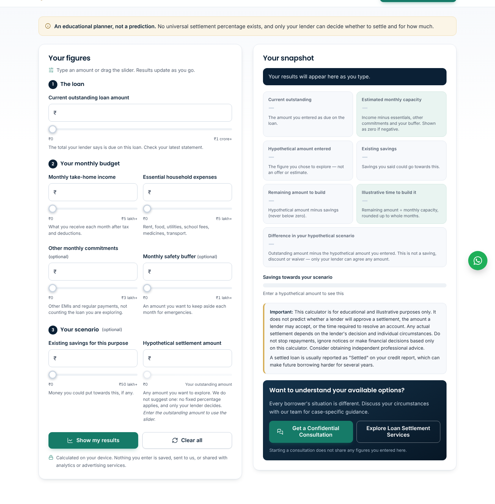
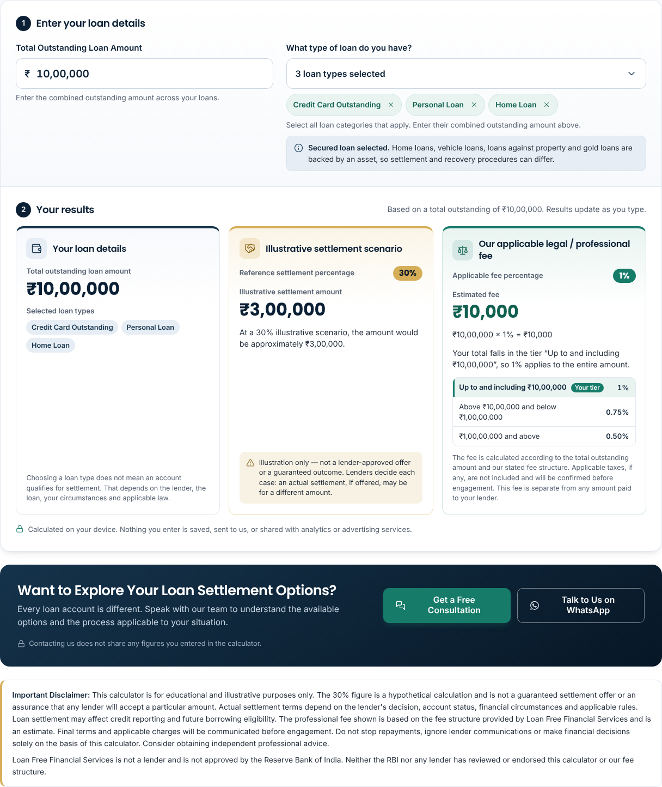
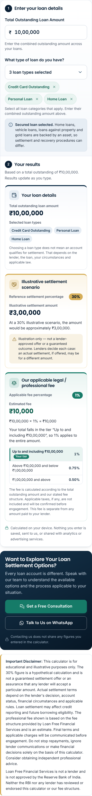
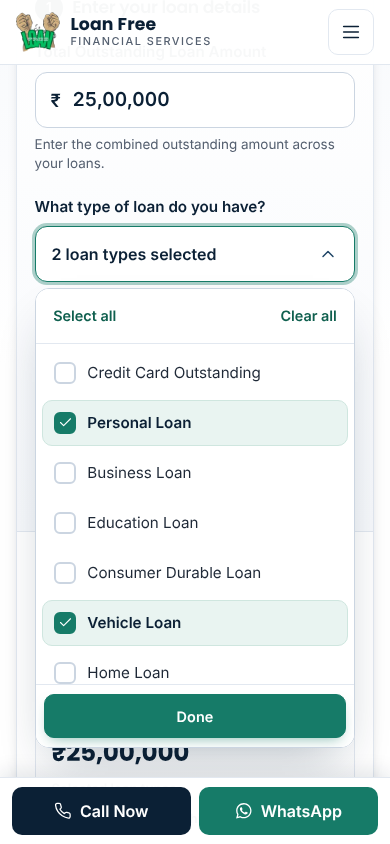
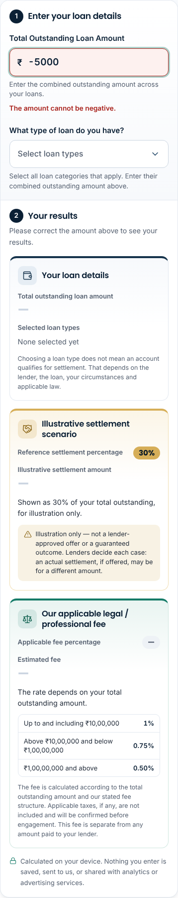

# Simplified Loan Settlement & Legal Fee Calculator — implementation report

Date: 3 Nov 2026 · Branch: `claude/serene-newton-af01oj` (from `main` at `753e402`) · URL: `/settlement-calculator.html` (unchanged)

**Status: built and tested on the branch. Not deployed.** No production deployment, merge or Vercel setting change has been made. Business and legal decisions listed in §9 should be settled before launch.

---

## 1. Summary of changes

The seven-field budget planner was replaced by a two-step calculator that a visitor can read at a glance:

1. **Enter** the total outstanding amount (₹, Indian grouping as you type) and, optionally, the loan types that apply (multi-select with checkboxes).
2. **See** three separate result cards, updated on every keystroke:
   - **Your loan details** — total outstanding and the selected loan types;
   - **Illustrative settlement scenario** — 30% reference and the illustrative amount, with a "not a lender offer / not guaranteed" note;
   - **Our applicable legal / professional fee** — the rate for the visitor's tier, the fee, the calculation (`₹10,00,000 × 1% = ₹10,000`), the tier explanation and the full fee table with the visitor's tier highlighted.
3. A **CTA** ("Want to Explore Your Loan Settlement Options?") with **Get a Free Consultation** (the existing consultation dialog and lead form) and **Talk to Us on WhatsApp** (the existing number and neutral message).
4. The business-supplied **disclaimer**, plus one line stating that neither the RBI nor any lender has reviewed or endorsed the calculator or fee structure.

The settlement figure and the fee are never added together, and the page says the fee is separate from any amount paid to a lender.

**Single source of truth.** Every business number — `SETTLEMENT_SCENARIO_PERCENT = 30`, the three fee tiers, the loan-type list and the input limit — lives in one `CONFIG` object at the top of `src/js/calculator.js`. The build reads the same object (`src/templates.mjs` → `expandCalcTokens`), so the 30% wording, the fee table, the worked-examples table, the FAQ answers (and their FAQPage structured data), the disclaimer, the promo box and the illustration are all generated from it. Changing a rate in `CONFIG` and rebuilding updates every place; `node tools/test-calculator.cjs` then shows which agreed examples changed.

| Area | What changed |
|---|---|
| `src/js/calculator.js` | Rewritten: `CONFIG`, pure functions (`parseAmount`, `validateAmount`, `settlementScenario`, `feeTier`, `legalFee`, `calculate`, formatting, live input grouping) and the browser binding (amount box, multi-select, chips, results, CTA focus). Same UMD pattern, same privacy rules, same single analytics event. |
| `src/templates.mjs` | New `calculator()` markup; `calculatorPromo()` text; new `expandCalcTokens()` for page copy generated from `CONFIG`. |
| `tools/build.mjs` | One line: expands the calculator tokens when pages load (so FAQ structured data sees the final text). |
| `src/css/site.css` | Old form, slider, budget-card and sticky-summary styles removed; new calculator styles added in the same section, using existing tokens (navy, green, gold, radii, shadows, fonts). |
| `src/pages/settlement-calculator.html` | New title, description, H1, subtitle; explanatory content rewritten for the new calculator (how it works, fee table, worked examples, limits, FAQs). RBI framework, risks, alternatives and sources sections kept. |
| `src/pages/index.html` | Homepage calculator section heading/intro/points and the knowledge-centre card text updated; same component, same `#calculator` anchor. |
| `src/pages/blog/how-to-request-emi-restructuring-from-bank.html` | One sentence that described the old budget calculator rewritten (it now gives the EMI budgeting rule in words and links to the new calculator). |
| `tools/scenes.mjs`, `assets/illustrations/calculator-planning.svg` | Illustration redrawn: total outstanding → two separate cards (30% scenario, fee). The old picture showed income/expenses/buffer bars, which no longer matched. Figures are computed from `CONFIG`. |
| `assets/og/settlement-calculator.jpg` | Share card regenerated with the new H1 (same template, `tools/media.mjs`). |
| `tools/test-calculator.cjs` | Rewritten: 62 unit tests. |
| `tools/qa/calculator-browser.mjs` | Rewritten for the new UI (Playwright): 227 browser checks. |
| Docs | This report; `docs/calculator/screenshots/`; superseded note on `PHASE_3_CALCULATOR_DOCUMENTATION.md`; new row in `LEGAL_REVIEW_LOG.md`; note in `IMAGE_INVENTORY.md`; `tools/qa/README.md`. |

## 2. Previous fields removed

| Removed field | Notes |
|---|---|
| Current outstanding loan amount | Replaced by **Total Outstanding Loan Amount** (combined across loans) |
| Monthly take-home income | Removed |
| Essential household expenses | Removed |
| Other monthly commitments | Removed |
| Monthly safety buffer | Removed |
| Existing savings for this purpose | Removed |
| Hypothetical settlement amount | Removed — replaced by the fixed 30% illustrative scenario |

Also removed: the seven sliders, the "Show my results" / "Clear all" buttons, the savings progress bar, the monthly-capacity / months-to-build / difference results and the mobile sticky summary. The budgeting idea survives only as one sentence in the restructuring guide.

## 3. New fields implemented

**Total Outstanding Loan Amount** — required.
- `₹` prefix, placeholder `10,00,000`, helper "Enter the combined outstanding amount across your loans."
- Indian grouping applied while typing, with the caret kept beside the digit being typed (e.g. typing into `10,00,000` gives `1,50,00,000`).
- Accepts `1000000`, `10,00,000`, `₹ 10,00,000`, `Rs. 1000000`, `INR …`, and paise (two decimals).
- No ₹1 crore cap. The only limit is a typing-error guard at ₹1,000 crore (`CONFIG.MAX_AMOUNT`).
- Messages: empty on Enter → "Please enter your total outstanding loan amount."; text → "Please enter the amount in numbers only, for example 10,00,000."; negative → "The amount cannot be negative."; zero → "Please enter an amount greater than zero."; above ₹1,000 crore → "That amount looks too large. Please check it." Errors use `aria-invalid` and `aria-describedby`; results show dashes, never ₹0.
- `inputmode="decimal"` (numeric keypad on phones), `autocomplete="off"`; Enter never submits or navigates.

**What type of loan do you have?** — optional multi-select.
- A button that opens a panel of native checkboxes for all 11 categories, with **Select all** / **Clear all** at the top and **Done** at the bottom (both sticky inside the panel).
- Selected options get a filled green box, tinted row and bold label; the button reads "Select loan types", the single type, "N loan types selected" or "All loan types selected"; removable chips below the button list the selection, and the results card repeats it.
- Closes on click/tap outside, on Escape (focus returns to the button), on Done, or when focus leaves it. Opening from the keyboard moves focus to the first option; ↑/↓ move between options; Space toggles.
- Phones: the panel is the width of the field, scrolls internally (max 62% of the screen height) and scrolls itself fully into view above the fixed Call/WhatsApp bar.
- Helper text as specified. Results card 1 adds: "Choosing a loan type does not mean an account qualifies for settlement. That depends on the lender, the loan, your circumstances and applicable law."
- **Secured-loan note** appears when Home Loan, Vehicle Loan, Loan Against Property or Gold Loan is selected: "Secured loan selected. Home loans, vehicle loans, loans against property and gold loans are backed by an asset, so settlement and recovery procedures can differ." A page FAQ expands on this and links the SARFAESI guide.
- Loan types never change the figures.

## 4. Settlement calculation

```
Illustrative settlement amount = Total outstanding × SETTLEMENT_SCENARIO_PERCENT / 100     (SETTLEMENT_SCENARIO_PERCENT = 30)
```

Calculated in paise, rounded to the nearest rupee for display. Shown as "Reference settlement percentage 30%" and "Illustrative settlement amount", with the sentence "At a 30% illustrative scenario, the amount would be approximately ₹3,00,000." and the caution "Illustration only — not a lender-approved offer or a guaranteed outcome. Lenders decide each case: an actual settlement, if offered, may be for a different amount."

No minimum, range or "savings"/"waiver"/"discount" figure is shown; the remaining 70% is not displayed anywhere.

## 5. Legal / professional fee calculation

Flat-rate tiers: the rate of the tier the **total** falls in applies to the **entire** amount (not slabs).

| Total outstanding | Rate | Rule in code |
|---|---|---|
| Up to and including ₹10,00,000 | 1% | `amount <= 10,00,000` |
| Above ₹10,00,000 and below ₹1,00,00,000 | 0.75% | `10,00,000 < amount < 1,00,00,000` |
| ₹1,00,00,000 and above | 0.50% | `amount >= 1,00,00,000` |

```
Fee = Total outstanding × rate of its tier        (rates held in basis points: 100 / 75 / 50; rounded to the nearest rupee)
```

The card shows the rate, the fee, the calculation line, "Your total falls in the tier "…", so X applies to the entire amount", and the fee table with "Your tier" highlighted. No GST or other charge is added; the card and FAQ say "Applicable taxes, if any, are not included and will be confirmed before engagement."

### Threshold effect — needs business confirmation

Because the rate drops for the whole amount when a threshold is crossed, the fee **falls** just above each threshold:

| Total outstanding | Rate | Fee |
|---|---|---|
| ₹10,00,000 | 1% | ₹10,000 |
| ₹10,00,001 | 0.75% | ₹7,500 (₹2,500 less) |
| ₹13,33,334 | 0.75% | ₹10,000.005 exact, shown ₹10,000 — first whole-rupee amount above ₹10 lakh whose exact fee is back to ₹10,000 |
| ₹99,99,999 | 0.75% | ₹74,999.99 exact, shown ₹75,000 |
| ₹1,00,00,000 | 0.50% | ₹50,000 (about ₹25,000 less) |
| ₹1,50,00,000 | 0.50% | ₹75,000 — first amount at or above ₹1 crore whose fee is back to ₹75,000 |

In other words, every total from ₹10,00,001 to ₹13,33,333 has an exact fee below the fee at ₹10,00,000, and every total from ₹1,00,00,000 to ₹1,49,99,998 has an exact fee below the fee at ₹99,99,999.

So a visitor with ₹1.2 crore outstanding sees a lower fee (₹60,000) than one with ₹95 lakh (₹71,250). This is implemented exactly as instructed. If the business prefers otherwise, common alternatives are (a) marginal slabs (1% on the first ₹10 lakh, 0.75% on the part up to ₹1 crore, 0.50% above; ₹25 lakh would then be ₹21,250), or (b) keeping the flat tiers but never charging less than the previous tier's maximum. Either is a small change to `legalFee()` and its tests.

## 6. Test cases and results

### Unit tests — `node tools/test-calculator.cjs`: **62 passed, 0 failed**

| Required case | Expected | Result |
|---|---|---|
| Settlement ₹10,00,000 | ₹3,00,000 | Pass |
| Settlement ₹25,00,000 | ₹7,50,000 | Pass |
| Settlement ₹1,00,00,000 | ₹30,00,000 | Pass |
| Fee ₹10,00,000 | 1% → ₹10,000 | Pass |
| Fee ₹10,00,001 | 0.75% | Pass (₹7,500) |
| Fee ₹25,00,000 | 0.75% → ₹18,750 | Pass |
| Fee ₹99,99,999 | 0.75% | Pass (₹74,999.9925 → ₹75,000) |
| Fee ₹1,00,00,000 | 0.50% → ₹50,000 | Pass |
| Fee ₹1,50,00,000 | 0.50% → ₹75,000 | Pass |
| Empty input | No result, "required" | Pass |
| Zero | No result, error | Pass |
| Negative | No result, error | Pass |
| Invalid input (text, mixed, NaN) | No result, error | Pass |
| Very large amounts | ₹500 crore exact; > ₹1,000 crore rejected | Pass |
| Multiple loan type selections | Kept, de-duplicated, in list order | Pass |
| Removing selected loan types | Removed from results | Pass |
| INR formatting | `₹10,00,000`, `₹1,00,00,000`, paise only when present, `0.50%` | Pass |

Also covered: config values and loan-type order, ₹10,00,000.01 boundary, "whole amount not slabs" (₹25 lakh ≠ ₹21,250), the documented threshold drop, tier ids, results never contain a combined/savings figure, secured-loan detection for every type, loan types never change figures, live input grouping, page tokens generated from `CONFIG`, and static privacy checks on the source (no storage, network, URL writes, console, Meta/dataLayer calls or WhatsApp links; exactly one `gtag('event', 'calculator_used')` with no parameters).

### Browser tests — `node tools/qa/calculator-browser.mjs`: **227 passed, 0 failed**

Run on the calculator page and the homepage at 1440 px and 390 px with "Accept all" cookies (strictest case), plus a responsive pass at 375 / 390 / 430 / 768 / 1024 / 1440 px.

- Empty state shows prompts and dashes, never ₹0.
- Typing `1000000` key by key shows `10,00,000`, ₹3,00,000 at 30%, 1% = ₹10,000, the exact supporting sentence and the highlighted first tier.
- Through the UI: ₹25 lakh, ₹10,00,001, ₹99,99,999, ₹1 crore, ₹1.5 crore and ₹500 crore all match the unit results.
- Caret position kept when grouping changes; invalid text, negative, zero and too-large values show the right message with `aria-invalid` and no results; empty + Enter shows "required" and keeps focus; Enter never changes the URL.
- Multi-select: open/close by click, outside click, Escape (focus back to button) and Done; keyboard open focuses the first option, ↓ moves, Space toggles; Select all / Clear all; selected state visible; chips and results card list the types; chip removal unchecks and moves focus sensibly; secured note appears and disappears.
- Privacy: no request, URL, storage entry or console message contains the entered amount, results or loan types; `calculator_used` is pushed once with no parameters; Meta Pixel is not loaded on the calculator page; on the homepage (a neutral URL) the pixel loads after consent but sends nothing while the calculator is used; no page errors.
- CTAs: WhatsApp button uses `wa.me/917042538878` with the standard neutral message; no WhatsApp link carries values; "Get a Free Consultation" opens the existing dialog with no values copied in; with `/api/lead` returning 503 the existing form still falls back to WhatsApp.
- Responsive: at every width, no horizontal scroll with ₹100 crore entered and the dropdown open; dropdown within the screen, below the header and with Done above the Call/WhatsApp bar; calculator touch targets ≥ 44 px (chip remove buttons are 34 px, above the 24 px WCAG 2.2 minimum).

Limitation: Google and Meta hosts are blocked from this build environment, so the tag scripts were stubbed and the analytics checks rely on `window.dataLayer` and on every request the page made. On a machine with internet access, `LIVE_TAGS=1 node tools/qa/calculator-browser.mjs` loads the real tags (beacons are still intercepted and inspected).

### Existing project checks

| Command | Before | After |
|---|---|---|
| `node tools/build.mjs` | 57 pages | 57 pages (59 icons; the unused slider icon dropped out of the sprite) |
| `node tools/check.mjs` | 0 errors, 0 warnings | **0 errors, 0 warnings** |
| `node tools/test-lead.cjs` | valid lead delivered; honeypot, too-fast, no consent, bad phone, bad origin, wrong secret handled | **Identical output** |
| Site-wide sweep (all 57 pages × 375/390/430/768/1024/1440 = 342 loads; Playwright port of `tools/qa/sweep.mjs`) | — | **0 with horizontal overflow, page errors or failed requests** |

## 7. Mobile and desktop QA

| Width | Layout | Checked |
|---|---|---|
| 375, 390, 430 | One column: amount → loan types → results cards → privacy line → CTA (stacked buttons) → disclaimer | No sideways scroll; ₹ input fits ₹1,000-crore values; dropdown fits and clears the call bar; 44 px targets; floating WhatsApp and Call/WhatsApp bar unchanged |
| 768 | Fields side by side (5:7); "loan details" and "scenario" cards side by side, fee card full width below | No overflow; dropdown one column |
| 1024 | Same fields; three cards in a row; dropdown in two columns | No overflow |
| 1440 | Same, in the 1280 px container; CTA copy left, buttons right | No overflow |

Accessibility: real `<label>`s, a visible step heading for each half, card headings, a polite live region that announces the two results once typing pauses (not on every keystroke), native checkboxes inside a fieldset with a legend, `aria-expanded`/`aria-controls` on the dropdown button, `aria-current` on the active fee tier, focus rings on every control. Heading levels follow the page (h2/h3 on the calculator page, h3/h4 on the homepage); `check.mjs` reports no heading skips.

## 8. Screenshots

All in `docs/calculator/screenshots/` (1× PNG). Element shots hide the fixed header and call bar so nothing overlaps; `after-dropdown-open-390-viewport.png` and `after-page-top-1440.png` are real viewports.

| Before (budget planner) | After — ₹10 lakh, three loan types |
|---|---|
|  |  |

| Phone 390 px | Dropdown on a phone (real viewport) | Invalid input |
|---|---|---|
|  |  |  |

Other files: `after-10-lakh-{375,430,768,1024}.png`, `after-empty-{390,1440}.png`, `after-dropdown-open-1440.png`, `after-1-crore-1440.png` (0.50% tier), `after-page-top-1440.png` (hero + illustration), `after-homepage-section-1440.png`, `before-390.png`.

## 9. Unresolved business and legal decisions

Please decide these before production. Nothing below has been changed on other pages.

1. **Fee threshold effect** (§5). Confirm the flat-tier rule, including the lower fee just above ₹10 lakh and ₹1 crore, or choose an alternative.
2. **Taxes and other charges.** Confirm whether GST or any other charge applies. The calculator currently states that taxes, if any, are not included and will be confirmed before engagement.
3. **"Legal fee" wording and who provides the service.** The footer and disclaimer say Loan Free is "not a law firm", and the operator entity (Athena Legal Solution LLP) is still unconfirmed (`SITE.operatorConfirmed: false`). Publishing a "legal / professional fee" schedule should be checked by a lawyer, in particular whether any of the work is done by advocates (Bar Council of India Rule 36 restricts advocates' advertising, which the site's own checker already flags for review). If needed, the label can become "professional fee" in one place (`src/templates.mjs` and the page FAQ).
4. **Basis for 30%.** Confirm the 30% reference figure is one the business can stand behind as an illustration. Phase 2 removed "fixed waiver percentages" as unsupported (`LEGAL_REVIEW_LOG.md`), the editorial policy rules out "predictions of a waiver percentage", and the homepage says "No waiver percentages". The calculator labels 30% as hypothetical everywhere it appears, but a reviewer should confirm that is enough, or supply a verified range. Changing `CONFIG.SETTLEMENT_SCENARIO_PERCENT` updates every mention.
5. **Fee wording elsewhere on the site** — not changed, to preserve approved text. These pages still say fees "depend on the work involved" or should be requested in writing, which now sits beside a published schedule: `faq.html#fees`, `about.html` (Fees), `services.html#fees`, `terms.html` (Fees), `process.html`, `personal-loan-settlement.html` FAQ, `loan-settlement-delhi.html` FAQ, homepage "Clarity on fees before you decide". Decide whether to align them, for example by pointing to the calculator.
6. **Banned-claims rule `fixed fees` → "no fees published"** in `tools/check.mjs`. Its reason is now out of date. It is still harmless and was left unchanged.
7. **Loan types optional.** They are not required to see results and do not change the figures. Confirm, or make them required.
8. **Secured-loan list.** The note covers home, vehicle, property and gold loans. Overdraft / cash credit and some education loans can also be secured. Confirm the list.
9. **Rounding and limits.** Results are rounded to the nearest rupee. Inputs above ₹1,000 crore are treated as typing errors. Confirm both.
10. **Navigation labels** still read "Settlement scenario calculator" / "Settlement Calculator". They were kept unchanged as instructed and are still accurate; rename them if you prefer.
11. **No Hindi version** of the calculator exists (same as before).
12. **Legal sign-off.** The calculator page is listed in `LEGAL_REVIEW_LOG.md` for independent review, like every other YMYL page.

## 10. Rest of the website

I built `main` (`753e402`) and this branch and compared every output file:

- **50 of 60** HTML/XML/TXT outputs are **identical** apart from the shared CSS and icon-sprite fingerprints, which change whenever the stylesheet changes. `site.js` (consent, tracking, navigation, consultation dialog, lead forms, WhatsApp fallback) is **byte-identical** (`site.9b8b6a03f2.js`).
- The outputs that changed are all expected:
  - the calculator page;
  - the homepage calculator section and its card;
  - the five pages that show the calculator promo box (personal loan, credit card, NBFC, OTS, settlement vs restructuring), where only the promo text changed;
  - one sentence in the restructuring guide;
  - `sitemap.xml`, where only the calculator's `lastmod` changed;
  - `llms.txt`, where only the calculator's title and description changed.
- **SEO:** the URL, canonical (`https://www.loanfree.info/settlement-calculator.html`), breadcrumbs, sitemap entry, extension-less redirect and all internal links are unchanged. The title is now "Loan Settlement Calculator & Legal Fee Estimator | Loan Free" (60 characters) and the description is as suggested (139 characters). Structured data on the page is ProfessionalService, BreadcrumbList, WebPage and FAQPage, with 8 FAQs, all valid. No new or duplicate pages were added.
- **Untouched:** `api/lead.js`, `vercel.json`, `src/site.config.mjs` (phone, WhatsApp number, analytics IDs, Meta-pixel page list), the header, footer, navigation, floating WhatsApp button, mobile Call/WhatsApp bar, consent banner and all blog and service content apart from the one sentence above.
- **Privacy rules from Phase 3 are unchanged.** Everything is calculated on the device. Nothing is stored or added to the URL. The only analytics call is the existing parameter-free `calculator_used`. Nothing is sent to Meta, and nothing from the calculator goes into WhatsApp. No new endpoint was added.

### Changing the numbers later

Edit `CONFIG` in `src/js/calculator.js`, then run:

```
node tools/build.mjs
node tools/check.mjs
node tools/test-calculator.cjs
```

`test-calculator.cjs` will flag the agreed examples that no longer hold; update them deliberately. Then regenerate the illustration with `node tools/scenes.mjs calculator-planning`; its example figures come from `CONFIG`.
